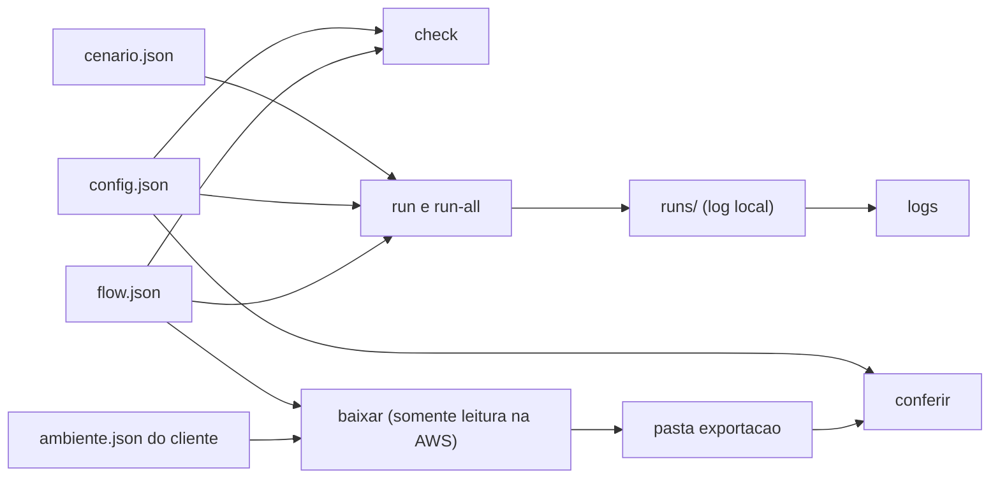

# connect-sim

Simulador local de contact flows do Amazon Connect. Ele executa o flow bloco a bloco na sua máquina, mostra o caminho percorrido e compara o resultado com o esperado, antes de publicar o flow na AWS.

Os comandos `check`, `run`, `run-all`, `logs` e `conferir` não chamam a AWS. Só o comando `baixar` lê recursos da conta, e apenas com chamadas de leitura (get, list, describe).

## Sumário

- [Como funciona](#como-funciona)
- [Recursos](#recursos)
- [Limites](#limites)
- [Requisitos](#requisitos)
- [Início rápido](#início-rápido)
- [Comandos](#comandos)
- [Como ler o passo a passo](#como-ler-o-passo-a-passo)
- [Cenários](#cenários)
- [Configuração por cliente](#configuração-por-cliente)
- [Regras que o check aplica](#regras-que-o-check-aplica)
- [Acesso à AWS](#acesso-à-aws)
- [Divergências aceitas](#divergências-aceitas)
- [Logs](#logs)
- [Testes](#testes)
- [Solução de problemas](#solução-de-problemas)
- [Estrutura](#estrutura)
- [Compartilhar](#compartilhar)
- [Licença](#licença)

## Como funciona



## Recursos

- Ramos por condição e por erro.
- Atributos de contato, `$.External` vindo de Lambda e `$.Views.ViewResultData` vindo de view.
- Criação de caso com validação dos campos do template.
- Fila alvo, transfer, desconexão e encerramento.
- Checagem estática do flow: estrutura do JSON, referências do config e regras de cada Action.
- Log de cada execução no formato de grupo e stream do CloudWatch.

## Limites

O simulador não reproduz áudio, prompts, Lex com NLU real, filas e agentes reais, cotas, nem o código publicado na Lambda.

Quando o flow usa um bloco sem simulador, a execução para com `NotSimulated`. O simulador não assume sucesso nesse caso.

## Requisitos

- Python 3.11. O `uv` baixa o Python 3.11 quando ele não está instalado.
- Nenhuma dependência externa para os comandos `check`, `run`, `run-all`, `logs` e `conferir`.
- boto3, no extra `aws`, para o comando `baixar`. Só ele importa boto3.

## Início rápido

Rode a partir da pasta `tools/connect-sim`:

```bash
uv run --python 3.11 -m connect_sim check --flow examples/flows/contato-referencia.json --config examples/config/generico.json
uv run --python 3.11 -m connect_sim run --flow examples/flows/contato-referencia.json --config examples/config/generico.json --scenario examples/scenarios/caminho-feliz.json
```

No Windows, `connect-sim.ps1` na mesma pasta aceita os mesmos argumentos e pode ser chamado de qualquer pasta. Ele usa o extra `aws`, então instala boto3 na primeira execução.

```powershell
.\connect-sim.ps1 check --flow examples/flows/contato-referencia.json --config examples/config/generico.json
```

## Comandos

### check

Checa a estrutura do flow e resolve as referências do config. Sai com código 1 quando acha erro.

```bash
uv run --python 3.11 -m connect_sim check --flow <flow.json> --config <config.json>
```

### run

Roda um cenário. Sai com código 1 quando o cenário falha.

```bash
uv run --python 3.11 -m connect_sim run --flow <flow.json> --config <config.json> --scenario <cenario.json>
```

### run-all

Roda todos os cenários de uma pasta. Sai com código 1 quando algum cenário falha, o que serve para CI. Use `--detalhe` para ver o passo a passo de cada cenário.

```bash
uv run --python 3.11 -m connect_sim run-all --flow <flow.json> --config <config.json> --scenarios <pasta>
```

### logs

Lista as execuções gravadas. Com `--stream`, mostra os passos de uma execução. Com `--only-problems`, mostra só os passos com erro ou aviso.

```bash
uv run --python 3.11 -m connect_sim logs --flow <flow.json>
uv run --python 3.11 -m connect_sim logs --flow <flow.json> --stream caso-sem-vinculo-<carimbo> --only-problems
```

## Como ler o passo a passo

Cada linha é um bloco executado, na ordem. Este é o cenário `caminho-feliz` rodado contra o flow e a config de exemplo:

```text
Cenario: caminho-feliz. Cliente existe, escolhe Reclamacao, caso abre e o contato vai para a fila.
#01 INFO  Definir_atributos        UpdateContactAttributes  grava Etapa='triagem'  -> Coletar_codigo
#02 INFO  Coletar_codigo           GetParticipantInput      entrada gravada em $.StoredCustomerInput: '000000000001'  -> Consultar_cliente
#03 INFO  Consultar_cliente        InvokeLambdaFunction     lookup_cliente devolveu ['nome', 'status']  -> Mostrar_triagem
#04 INFO  Mostrar_triagem          ShowView                 view 'triagem' respondeu acao 'Enviar'  -> Gravar_motivo
#05 INFO  Gravar_motivo            UpdateContactAttributes  grava Motivo='Reclamacao'  -> Verificar_motivo
#06 INFO  Verificar_motivo         Compare                  compara 'Reclamacao'  -> Abrir_caso
#07 WARN  Abrir_caso               CreateCase               caso case-0001 criado no template 'caso_padrao'  -> Definir_fila
     WARN  campo de sistema 'created_by' ficou vazio; o fluxo nao preenche
#08 INFO  Definir_fila             UpdateContactTargetQueue fila alvo: atendimento  -> Transferir_fila
#09 INFO  Transferir_fila          TransferContactToQueue   contato colocado na fila 'atendimento'  -> Encerrar
#10 INFO  Encerrar                 EndFlowExecution         encerra o fluxo
caminho-feliz: PASSOU (end_flow)
log: runs\connect-sim\contato-referencia\caminho-feliz-20261126T194727Z
```

Os marcadores têm estes sentidos:

- `ERROR` é um erro do Connect tratado por um ramo do flow. Sem ramo para o erro, a execução para com `outcome` igual a `unhandled_error`, e `failed_at` aponta o bloco.
- `WARN` é um aviso que não para o fluxo.
- `-> Definir_fila` mostra o bloco para o qual o fluxo seguiu.

## Cenários

Um cenário é um JSON com estas chaves:

- `inputs`: o que o cliente responde.
- `views`: o que o agente responde na view.
- `queues`: o estado das filas.
- `lambdas`: o retorno de Lambda ou uma falha simulada.
- `expect`: o resultado esperado.

O cenário `caminho-feliz` mostra as chaves principais. O cliente digita o código `000000000001`, o agente escolhe `Reclamacao` na view e o contato vai para a fila:

```json
{
  "name": "caminho-feliz",
  "description": "Cliente existe, escolhe Reclamacao, caso abre e o contato vai para a fila.",
  "inputs": ["000000000001"],
  "views": {
    "triagem": [{"action": "Enviar", "data": {"motivo": "Reclamacao"}}]
  },
  "expect": {
    "outcome": "end_flow",
    "path": [
      "Definir_atributos", "Coletar_codigo", "Consultar_cliente", "Mostrar_triagem",
      "Gravar_motivo", "Verificar_motivo", "Abrir_caso", "Definir_fila",
      "Transferir_fila", "Encerrar"
    ],
    "attributes": {"Etapa": "triagem", "Motivo": "Reclamacao"}
  }
}
```

O bloco `expect` pode checar `outcome`, `path` (lista exata de blocos), `failed_at` e `attributes`. Um cenário sem `expect` passa quando o flow termina em `end_flow` ou `disconnected`.

Valores de `outcome`:

- `end_flow`: EndFlowExecution.
- `disconnected`: DisconnectParticipant.
- `unhandled_error`: erro sem ramo no flow.
- `config_error`: um placeholder do flow não tem valor no config.
- `loop_limit`: o flow passou de 200 passos sem sair.

Ação de view em cenário e em flow pode usar placeholder, como `{{view.triagem.acao_enviar}}`. A config lista as ações da view em `acao_*` (ou na lista `actions`). Uma ação que a view não responde falha antes da execução.

### Divergência conhecida

Um cenário com `"expect_divergence": true` passa quando a execução diverge do bloco `expect`. Sem divergência, o cenário falha, porque o problema conhecido deixou de reproduzir. Um cenário com `expect_divergence` sem bloco `expect` falha com erro de configuração.

## Configuração por cliente

O flow não traz IDs reais. Ele usa placeholders, como `{{queue.atendimento.id}}`, `{{view.triagem.id}}`, `{{template.caso_padrao.id}}`, `{{field.caso_padrao.motivo}}` e `{{lambda.lookup_cliente.arn}}`. O arquivo de config dá o valor de cada placeholder, então o mesmo flow genérico serve a vários clientes.

Para criar a config de um cliente novo:

1. Copie `examples/config/generico.json` para `work/<cliente>/config/`.
2. Troque os IDs pelos do cliente.
3. Aponte o campo `local` de cada Lambda para o código Python que o simulador roda no lugar da função publicada.

Para um cenário que não precisa rodar o código, use `"lambdas": {"nome": {"response": {...}}}`.

Campo `opcoes`: aponta para um arquivo local com as opções de um campo SingleSelect. O `check` acusa qualquer Compare sobre o atributo configurado que teste um valor fora das opções ativas. Isso vale também para módulos chamados por `InvokeFlowModule` com `{{module.<nome>}}`.

## Regras que o check aplica

- Estrutura do JSON: Identifier, Type, Transitions, NextAction e operadores.
- Regras de cada Action, extraídas das páginas da documentação oficial: erros aceitos por Action, faixa de `InvocationTimeLimitSeconds` (1 a 8), ramo `NoMatchingError` obrigatório no GetParticipantInput e Lambda sem Conditions.
- Campos de sistema do template de caso que o flow não preenche, como `created_by`.
- Entradas do config que o flow não usa.

Tipos de Action sem regra verificada recebem só a checagem estrutural. Para ampliar, consulte a página da Action com `get_action_doc` e acrescente a regra em `connect_sim/flow.py`.

## Acesso à AWS

### baixar

Baixa da conta só os recursos que os flows informados usam: views, módulos e templates alcançados por eles, os catálogos de opções do config e o agente de teste.

Conta, perfil, região, instância e domínio vêm do arquivo de ambiente do cliente, o mesmo que a esteira lê (por exemplo, `work/<cliente>/config/stg.json`). O config do simulador traz só os IDs dos recursos.

Os arquivos vão para a pasta `exportacao` do config, que precisa ficar dentro de `work/<cliente>/`. O config também precisa estar em `work/<cliente>/config/`. Se algum dos dois estiver fora, o comando para antes de qualquer chamada à AWS.

```bash
uv run --python 3.11 --extra aws -m connect_sim baixar --config work/<cliente>/config/sim-stg.json --ambiente work/<cliente>/config/stg.json --flow work/<cliente>/02-flows/<fluxo>.json
```

Use `--dry-run` para listar o que seria baixado sem chamar a AWS. Repita `--flow` para baixar os recursos de mais de um flow.

### conferir

Compara o export com o config e com os arquivos locais. Não chama a AWS. Sai com código 1 quando há divergência.

```bash
uv run --python 3.11 -m connect_sim conferir --config <sim-config>
```

## Divergências aceitas

Divergências já revisadas ficam no arquivo indicado em `divergencias_aceitas` do config. O `conferir` mostra essas linhas com `[aceita]` e só falha por divergência nova.

Com `--aceitar-atuais`, o `conferir` grava as divergências atuais nesse arquivo. Use a opção só depois de revisar a lista. Uma divergência que some do export continua no arquivo, então revise o arquivo de tempos em tempos.

## Logs

Cada execução grava em `runs/connect-sim/<flow>/<cenario>-<carimbo UTC>/`:

- `events.jsonl`: um registro por bloco executado.
- `summary.json`: o veredito, o caminho percorrido, os atributos finais e os casos criados.

A opção `--manter` define quantas execuções ficam guardadas por cenário (padrão: 20). A pasta `runs/` fica fora do git.

## Testes

Os testes unitários rodam offline, sem AWS:

```bash
uv run --python 3.11 --extra test python -m pytest tests -q
```

Cada teste monta o próprio cliente temporário, com IDs inventados.

## Solução de problemas

- `uv` não é reconhecido: instale o uv seguindo o [guia oficial](https://docs.astral.sh/uv/getting-started/installation/) e abra um terminal novo para o PATH atualizar.
- `connect-sim.ps1` bloqueado pela política de execução do PowerShell: rode uma vez com `powershell -ExecutionPolicy Bypass -File .\connect-sim.ps1 <comando> ...`. Essa forma não muda a configuração do Windows.
- `check` ou `run` com `config_error`: um placeholder do flow não existe no config. O passo que parou mostra o nome do placeholder ausente.
- `run` com `unhandled_error`: um bloco falhou e o flow não tem ramo para o erro. `failed_at` no `summary.json` aponta o bloco.
- Execução parada em `NotSimulated`: o flow usa um bloco sem simulador. O simulador não valida o que vem depois desse bloco.
- `baixar` com mensagem `config fora de work/<cliente>/config`: mova o config para `work/<cliente>/config/`.
- `baixar` com mensagem `'exportacao' aponta para fora de`: ajuste o campo `exportacao` no config para um caminho dentro de `work/<cliente>/`.
- `baixar` sem boto3: rode com `--extra aws`, como nos exemplos, ou use o `connect-sim.ps1`, que já inclui o extra.
- `conferir` sai com código 1: apareceu divergência nova. Revise a linha indicada. Se ela for aceita, use `--aceitar-atuais` depois de revisar.

## Estrutura

```text
connect_sim/
  cli.py          comandos
  flow.py         checagem estática
  engine.py       execução passo a passo
  config.py       placeholders e config do cliente
  resources.py    casos e carregamento de Lambda local
  scenario.py     cenários e expectativas
  logs.py         log local no formato de grupo e stream
  baixar.py       download somente leitura da AWS
  conferir.py     comparação do export com o config
examples/
  flows/          flow genérico de referência
  config/         config de exemplo com IDs fictícios
  lambdas/        Lambda local de exemplo
  scenarios/      cenários de exemplo
tests/            testes unitários, offline
```

## Compartilhar

A pasta inteira vai junto: código, exemplos e este README. Não há instalação. Quem tiver o `uv` roda os comandos acima.

Os IDs dos exemplos são fictícios. Os IDs de cliente real ficam só em `work/<cliente>/config/`, fora deste pacote.

## Licença

Distribuído sob a [licença MIT](LICENSE). Qualquer pessoa pode usar, copiar, modificar e distribuir o código, inclusive em projetos comerciais, desde que mantenha o aviso de copyright.
